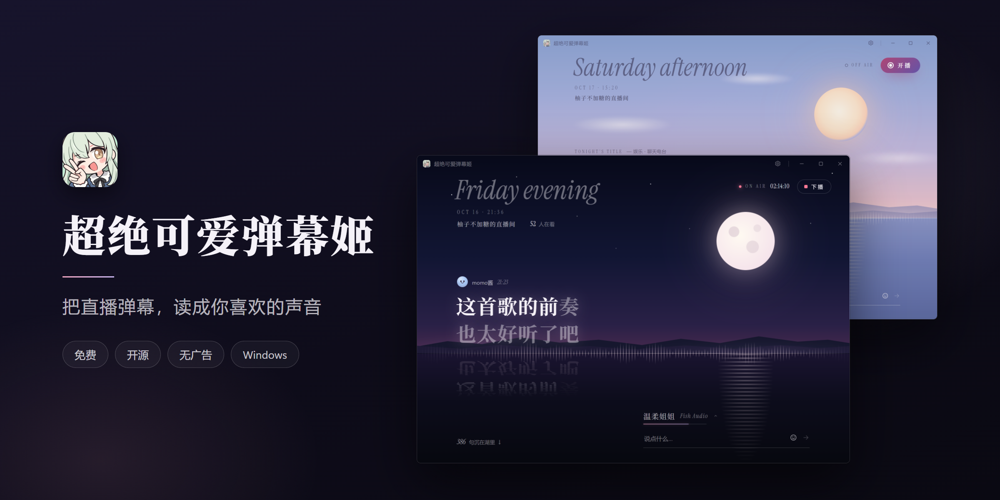
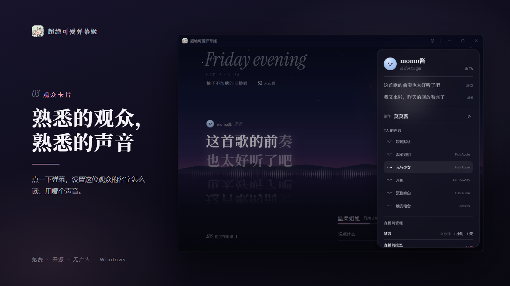
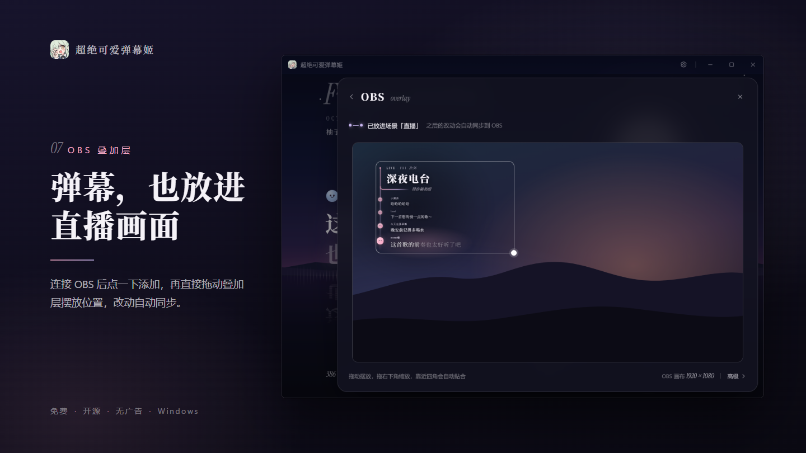
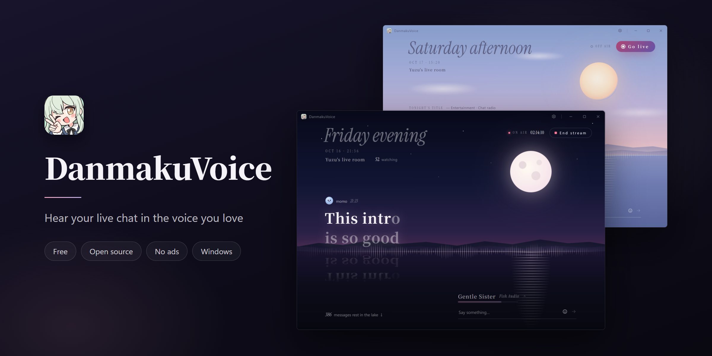

<div align="center">



# 超绝可爱弹幕姬

**把 B 站直播弹幕，读成你喜欢的声音。**

[**从 Microsoft Store 获取**](https://apps.microsoft.com/detail/9P4DFD8HGN03) · [English](#english) · [隐私说明](docs/PRIVACY.md) · [问题反馈](https://github.com/Ghou133/DanmakuVoice/issues)


</div>

超绝可爱弹幕姬是一款 Windows 桌面工具：接收哔哩哔哩直播间的弹幕、礼物、醒目留言和上舰消息，按你定的规则用喜欢的声音读出来。正在读的那一句浮在月下的湖面上，水里是它的倒影；读过的弹幕沉进湖里，往下滚就能翻看。不想听的时候关掉播报，弹幕照常显示。

## 亮点

|            |                                                              |
| ---------- | ------------------------------------------------------------ |
| **倒影朗读**   | 正在读的那一句留在地平线上，倒影跟着读到的字一起亮起。鼠标移到水面，刚读过的几句浮上来；往下滚潜进水下，翻看本场全部弹幕。 |
| **声音随手换**  | 点右下角的声音名字，切换音色、开关播报，悬停先试听。名字下的水线就是音量，滚轮调节，点一下静音。 |
| **多种声音**   | 豆包扫码即用；Fish Audio 填写 API Key；也可以连接自己部署的 dots.tts、GPT-SoVITS，服务没开时点一下就启动。 |
| **观众专属**   | 点一下弹幕，设置这位观众的名字怎么读、用哪个声音，顺便看看 TA 今晚说过的话。 |
| **记住的读法**  | 观众名字、正文用词和表情的读法收在一页；消息类型、金额门槛、播报模板和关键词音效放在“高级”里。 |
| **开播与 OBS** | 在主界面开播、下播、原地改标题；连接 OBS 后一键放入叠加层，直接拖动摆放，改动自动同步。 |
| **晨雾与夜幕**  | 点太阳或月亮切换两套主题；简体中文／English 界面，设置改动自动保存。 |

<table>

  <tr>

    <td width="50%"></td>

    <td width="50%"></td>

  </tr>

  <tr>

    <td width="50%"></td>

    <td width="50%"></td>

  </tr>

</table>

## 安装

在 [Microsoft Store](https://apps.microsoft.com/detail/9P4DFD8HGN03) 安装，更新也由商店管理；可用版本与上架状态以商店页面为准。

- 系统：Windows 10 2004 或更新版本 / Windows 11，x64
- 需要 Microsoft Edge WebView2 Runtime（Windows 11 已自带）
- 音频组件 FFmpeg 随安装包提供，无需另行配置

## 三步上手

欢迎页点“开始”后，右侧抽屉里只有三步：

1. **连接直播间**：用哔哩哔哩 App 扫码登录，自动找到自己的直播间。
2. **选择声音**：用豆包播报，或暂时只看弹幕，之后随时可以在设置里添加其他声音。
3. **准备好了**：确认直播间和声音，进入直播间。以后启动会自动尝试连接上次的直播间。

## 主界面

- **湖面**：正在读的弹幕在地平线上方，水里是倒影。左下角写着“N 句沉在湖里”，鼠标停在水面上，最近 3 条浮上来，点一条打开观众卡片。
- **湖底**：往下滚潜进水下，按时间倒序翻看本次运行收到的全部弹幕，右边是本场句数、时长和说过话的人数；往上滚或点“回到水面”浮回去。
- **右下角**：点声音名字打开声音面板（播报开关、切换和试听、管理声音）；在声音这一行滚轮调音量，点名字下的水线静音或恢复。下面的“说点什么…”可以发送弹幕和表情。
- **右上角**：开播、下播和直播计时；还没开播时，点标题原地修改标题和分区，需要人脸验证时会显示二维码。
- **其他**：点太阳或月亮切换晨雾、夜幕；点“N 人在看”查看在看的观众；右上角齿轮打开设置抽屉。

主界面刻意保持安静：没有待读列表和跳过按钮，播报规则和其他服务都在设置里。

## 设置

设置是浮在湖面上的玻璃抽屉，主界面留在后面，改了声音马上能听到：

- **直播间**：账号、扫码换号、直播间号、退出登录。
- **声音**：默认声音和试听句，所有声音一张列表，原地改名字、语速、音量和参考音频；右上角“+”在一页里添加声音。
- **OBS**：连接 OBS WebSocket，连上后抽屉变宽成画布。“添加到 OBS”放入当前场景，拖动摆放、拖右下角缩放、双击主/副标题改字；“高级”里是连接参数、显示哪些消息和开播联动。
- **记住的读法**：观众名字读法和专属声音、正文用词、表情读法，搜索和添加都在原地。
- **通用**：界面语言、开机时启动、导出与恢复备份。
- **高级**：播报哪些消息和金额门槛、播报模板、关键词音效、合并连续礼物，以及一键恢复默认。

## 语音服务

| 服务         | 怎么连接              | 说明                                   |
| ---------- | ----------------- | ------------------------------------ |
| 豆包         | 应用内扫码登录           | 选择音色即可使用                             |
| Fish Audio | 在设置中填写自己的 API Key | 可选内建或自定义音色；自动使用 Windows 中已启用的代理服务器设置 |
| dots.tts   | 选择已安装的服务目录与参考音频   | 服务与模型需自行准备，参考音频保留在原位置                |
| GPT-SoVITS | 选择已安装的服务目录        | 自动配对角色模型；服务与模型需自行准备                  |

都在“设置 → 声音 → +”里连接和添加。第三方服务可能需要独立账号、API Key 或自行部署，服务商可能另行收费。本应用不包含语音模型，也不提供第三方账号或额度。

## 使用小贴士

- **观众卡片**：点击任意弹幕打开，设置“读作”和专属声音；也可以在“设置 → 记住的读法”里管理。有权限时可以禁言 1 小时／1 天、直播间拉黑（再点一次确认）或任免房管；B站接口目前只支持整小时，10 分钟一项暂不可用。
- **关闭播报不等于断开**：关掉声音面板里的“播报”后，弹幕照常接收和显示；连接管理在“设置 → 直播间”。
- **本地服务**：声音面板里虚线表示服务没开，点一下由本程序启动，就绪后自动选中；由本程序启动的 dots.tts／GPT-SoVITS 会在退出时一并关闭，你自己启动的外部服务不受影响。
- **开播联动**：在“设置 → OBS → 高级”开启后，开播会自动启动 OBS（如未运行）并开始推流，下播先停推流再关直播间。详见 [开播说明](docs/BROADCAST.md)。
- **界面语言**：在“设置 → 通用 → 语言”切换，立即生效。界面语言不会改变弹幕原文、用户名、音色名称或你写的播报模板。
- **后台运行**：最小化或切到后台时，界面暂停刷新，接收与播报继续。托盘菜单提供“显示窗口”和“退出”。
- **音频与缩放**：跟随 Windows 默认输出和系统 DPI，在 Windows 设置中调整。

## 隐私与数据

- 数据保存在 Windows 当前用户的 `AppData\Local\DanmakuVoice`，通过系统 Known Folder API 定位，独立于 EXE 文件名、版本、安装位置和工作目录。别名和专属声音绑定随数据库保存。商店版使用 Windows 默认的应用数据虚拟化，不承诺与便携版共用同一份数据。登录凭据和 API Key 使用 Windows 当前用户范围的 DPAPI 加密保存。
- 应用没有开发者运营的数据收集服务器、广告或使用统计。待播报文字只会发送给你选择的语音服务。
- “设置 → 通用”可以导出配置备份或恢复自己的备份。备份不含凭据、音效文件和聊天记录；恢复前会备份当前配置。音效文件需另行保留。
- 湖底的完整历史只保存在本次运行的内存里，退出后不保留正文。
- 请不要公开分享整个数据目录。完整说明见 [隐私说明](docs/PRIVACY.md)。

想用一份独立的数据试用，可以指定另一个数据目录：

```powershell
.\DanmakuVoice.exe --data-dir "D:\DanmakuVoice-Test"
```

## 问题反馈

报错会显示中文说明和末尾的短代码，例如 `音频组件 FFmpeg 无法启动… [DV-C02]`。[提交问题](https://github.com/Ghou133/DanmakuVoice/issues)时请附上程序版本、操作步骤和完整报错截图（保留错误代码）。**不需要、也请不要**提供 Cookie、API Key 或整个数据目录。错误码对照见 [ERROR-CODES.md](docs/ERROR-CODES.md)。

哔哩哔哩与豆包使用网页接口，接口变化可能影响登录与连接。

## 从源码构建

需要 Windows x64、[指定版本的 Rust 工具链](rust-toolchain.toml)、Visual Studio C++ 构建工具和 Windows SDK。界面随程序嵌入，不需要 Node.js 运行时。

```powershell
cargo build --locked --release -p danmakuvoice
cargo test --locked --workspace
```

发行包使用静态 CRT，构建与音频组件说明见 [FFMPEG.md](docs/FFMPEG.md)。同版 `DanmakuVoice-source.zip` 包含锁定的依赖和 FFmpeg 源码，解压后运行 `scripts/build-from-source.ps1 -VerifyOnly` 核验，或运行 `scripts/build-from-source.ps1` 离线构建（仍需预先安装工具链和 Windows SDK）。

GitHub Actions 会在提交、PR 和版本标签上执行验证，生成商店提交用的 MSIX 和同提交的完整源码包；不会自动提交微软审核，也不会把未签名的安装包当作正式版本发布。商店流程见 [STORE-PUBLISHING.md](docs/STORE-PUBLISHING.md)，商店文案见 [STORE-LISTING.md](docs/STORE-LISTING.md)。本页和商店的预览图由 `scripts/render-store-screenshots.cjs` 用虚构资料离线生成。

开发文档：[架构](ARCHITECTURE.md) · [界面设计与验收](docs/UI-DESIGN.md) · [桌面命令](docs/UI-IPC.md) · [发行材料核验](docs/RELEASE-LICENSE-AUDIT.md) · [进度与验证记录](PROGRESS.md)

## 许可与致谢

- 代码采用 [AGPL-3.0-only](LICENSE)。正式分发须提供对应的完整源码。
- 功能与旧配置格式参考了 [kinoko7danmaku](https://github.com/MerlinCN/kinoko7danmaku)（GNU AGPL v3 © MerlinCN）及其 [Ghou133 分支](https://github.com/Ghou133/kinoko7danmaku)；本项目独立维护。
- FFmpeg 以独立子进程运行，使用 LGPL 2.1 或更高版本。第三方组件与素材说明集中在 [NOTICE.md](NOTICE.md)。
- 应用图标为插画作品，作品与角色权利归原权利人，代码许可证不授予这些权利；说明见 [ARTWORK.md](crates/desktop/icons/ARTWORK.md)。

本项目为独立开发，与哔哩哔哩、豆包、Fish Audio 无官方隶属关系。预览图中的用户名、直播间、弹幕和声音名称均为虚构示例。

---

<a id="english"></a>

<div align="center">



## DanmakuVoice

**Hear your Bilibili live chat in the voice you love.**

[**Get it from Microsoft Store**](https://apps.microsoft.com/detail/9P4DFD8HGN03)

</div>

DanmakuVoice (超绝可爱弹幕姬) is a free, open-source Windows app that receives chat messages, gifts, Super Chats and memberships from a Bilibili live room and reads them aloud with the voice you choose. The line being read floats above a moonlit lake with its reflection below; past messages sink into the lake, one scroll away.

- **Reflections** – the reflection lights up as each word is spoken. Hover over the water for the last few lines, or scroll down to browse every message from this session.
- **A new voice in one click** – click the voice name to switch voices or turn speech on and off. The waterline under it is the volume: scroll to adjust, click to mute.
- **Many voices** – Doubao (sign in by QR code), Fish Audio (your own API key), or your self-hosted dots.tts and GPT-SoVITS, started with one click when they are off.
- **Per-viewer voices** – click a message to set how a name is pronounced and which voice that viewer gets.
- **Saved readings** – viewer names, words and emoticons on one page; message types, thresholds, templates and keyword sounds wait under Advanced.
- **Go live with OBS** – go live, end the stream and edit the title from the main screen. Add the chat overlay to OBS with one click and drag it into place.
- **Mist and Night** – click the sun or moon to switch themes. Simplified Chinese and English interface, settings saved automatically.

**Requirements:** Windows 10 2004 or later / Windows 11 (x64) and Microsoft Edge WebView2 Runtime. FFmpeg is bundled.

**Getting started:** choose Start, scan the QR code with the Bilibili app, choose Doubao or "View messages for now", then enter the room. Other voice services are under Settings > Voices > +.

**Privacy:** data lives in `%LOCALAPPDATA%\DanmakuVoice` (the Store version uses Windows app data virtualization); credentials and API keys are encrypted with Windows DPAPI for the current user. There is no developer-run telemetry or advertising. Text to be spoken is sent only to the voice service you choose. See the [privacy notes](docs/PRIVACY.md) (Chinese).

**Build from source:** Windows x64, the pinned [Rust toolchain](rust-toolchain.toml), Visual Studio C++ build tools and the Windows SDK.

```powershell
cargo build --locked --release -p danmakuvoice
cargo test --locked --workspace
```

**License:** [AGPL-3.0-only](LICENSE). Third-party notices are in [NOTICE.md](NOTICE.md). DanmakuVoice is an independent project and is not affiliated with Bilibili, Doubao or Fish Audio. Names, messages and voice names shown in the preview images are fictional.
